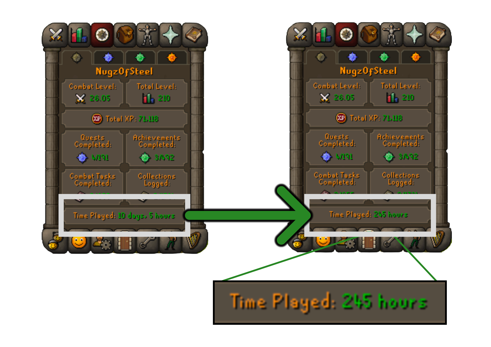

<h1 style="color:#B8860B; font-size: 2.4em; margin: 0;">Time Played in Hours</h1>

 

<Strong>Plugin that lets you view Character Summary</strong> Time Played in hours.

Easy to use: Simply install the plugin and toggle ON to display Time Played in hours. Toggle OFF to return to the default days + hours format.

[Release Notes](RELEASE_NOTES.md)
